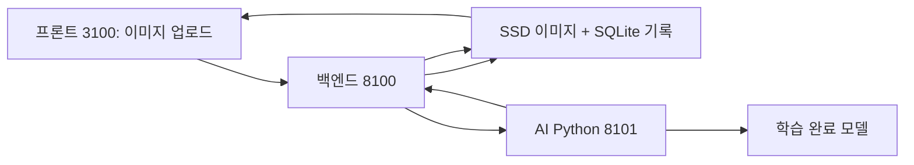

# 개인 통합본 실행 안내

## 저장공간과 ID

이미지·분석 결과·ID는 `E:/AI_Work/edgefire_private_storage`에 저장합니다. `metadata.sqlite`는 기록, `objects/`는 이미지, `runtime.json`은 로컬 인증키와 설정입니다. 이 파일들은 GitHub에 올리지 않습니다. `EDGEFIRE_RUNTIME_ROOT` 환경변수로 위치를 바꿀 수 있습니다.

프로젝트 PRJ_, 저장공간 STO_, 사용자 소유자 USR_, 카메라 CAM_ ID는 UUID로 생성해 유지합니다. 외부 서비스 가입 계정이나 실제 센서 하드웨어 ID는 아닙니다. 실제 센서는 담당자가 제공한 장치 ID와 추가 매핑해야 합니다.

GitHub에는 코드와 약 6.6MB 첫 모델을 보관합니다. 원본 663GiB는 SSD에 유지하며 팀원 PC에 전체 복사할 필요가 없습니다.

## 실행

Windows Python 3.12와 Node.js가 필요합니다. 저장소 루트에서:

```powershell
py -m pip install -r edgefire_AI/requirements.txt -r edgefire_AI/requirements-vision-training.txt -r edgefire_back/requirements.txt -r integration/requirements.txt
cd edgefire_front
npm ci
npm run build
cd ..
py integration/run_local.py start
```

화면: http://127.0.0.1:3100

```powershell
py integration/run_local.py status
py integration/run_local.py stop
```

서버는 127.0.0.1에 바인딩해 이 노트북에서만 접속됩니다. 팀원 외부 접속용 클라우드·도메인·가입 계정은 아직 만들지 않았습니다. 노트북 종료·절전·SSD 연결 해제 시 학습과 서비스가 중단될 수 있습니다.

## 데이터 흐름



프론트의 서버 경로 /api/edgefire가 인증키를 보관합니다. 키를 브라우저 번들이나 NEXT_PUBLIC_ 변수에 넣지 않습니다. POST는 허용한 로컬 Origin만 받으며 백엔드와 AI POST는 X-API-Key로 보호합니다. JPEG/PNG/WEBP, 10MiB·3천만 픽셀 이하를 허용하고 파일명 대신 생성한 객체 ID로 저장합니다.

실패를 정상·안전으로 대체하지 않습니다. 재시작 때 미완료 작업은 실패로 표시하고 재시도할 수 있습니다. 외부 작업 큐가 없는 단일 노트북 연구용 구성입니다.

## 학습 코드와 결과

현재 학습은 노트북 Python 3.12/PyTorch CPU에서 실행합니다.

- edgefire_AI/prepare_vision_dataset.py: 전체 목록 대조와 첫 표본 변환
- edgefire_AI/audit_vision_labels.py: 전체 라벨 본문 검사
- edgefire_AI/expand_vision_dataset.py: 평가 표본 고정, 카메라 균형·프레임 간격 적용
- edgefire_AI/train_vision.py: 미세조정, 체크포인트 저장, 평가·모델 비교
- edgefire_AI/VISION_TRAINING_V2.md: 두 번째 실험 설정

첫 모델은 1,197장으로 10 epoch 학습했으며 시험 객체 탐지 mAP50 0.2410, 마스크 mAP50 0.2021입니다. 두 번째는 2,598장, 입력 512, 최대 15 epoch입니다. 시험 결과를 이미 확인했으므로 이후 비교는 탐색적 비교이며 독립 최종 검증이 아닙니다.

선정 기준은 검증 성능, 연기·화염 재현율, 오탐, 처리 시간입니다. 현재 모델이 최적이라고 확정하지 않았습니다. 영상 중복·실제 장소 중복·마스크 자기 교차 검사와 추가 모델 비교가 필요합니다. 영상 분류 점수는 산불 발생 확률이나 안전 판정이 아닙니다.

첫 모델 파일은 models/vision_pilot_v1.pt이며 models/manifest.json의 SHA256으로 확인합니다. 기존 환경 분류·합성 가스·화학물성은 별도 모델과 카탈로그가 필요합니다. 합성 가스 모델은 실측 가스 위험을 검증하지 않았습니다.

## 검증과 원본 보존

추가 조사에서 카메라 분할 간 같은 장소명과 시각 유사 사례를 확인했습니다. 기존 실험은 독립 장소 검증으로 간주하지 않습니다. 다음 데이터·평가 계획은 [장소 평가 안내](../edgefire_AI/SPATIAL_EVALUATION.md)를 참고하세요. 학습 진행과 함께 더 엄격한 장소·마스크 전처리를 준비 중입니다.

```powershell
py integration/test_storage.py
```

프론트 TypeScript·production build, 인증 거부, 이미지 저장·조회, 경로 안전성을 검사합니다. 개인 실행 복사본은 Next.js 16.4.6으로 업데이트했습니다. team_snapshot은 업데이트하지 않은 공유팀 원본 보관본으로 실행 대상이 아닙니다.
